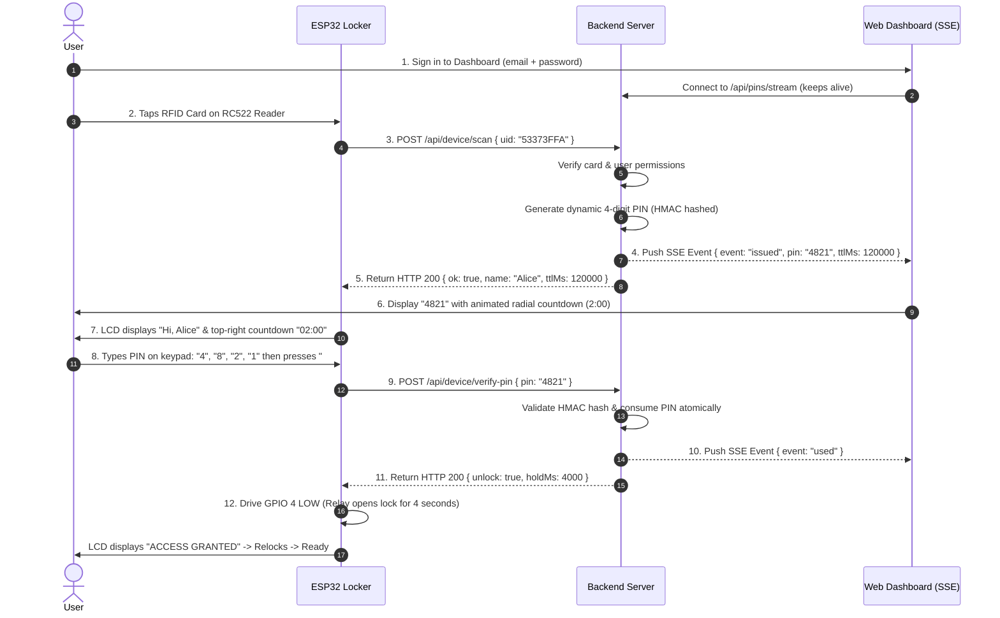
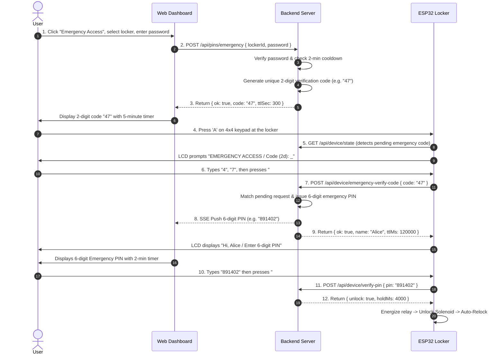

# 🔐 IoT Smart Locker System

> An end-to-end, high-security IoT Smart Locker system featuring **Two-Factor Authentication (RFID + Dynamic Real-Time Web PIN)**, **Emergency Code Verification (Lost-Card Recovery)**, **Hardware Keypad & LCD Interface**, and a **Modern Web Management Dashboard**.

---

## 📋 Table of Contents
1. [System Overview & Architecture](#-system-overview--architecture)
2. [Key Features](#-key-features)
3. [Repository Structure](#-repository-structure)
4. [Hardware Components & Pinout Mapping](#-hardware-components--pinout-mapping)
5. [System Workflows](#-system-workflows)
   - [Workflow 1: Standard 2-Factor Authentication (RFID + Dynamic PIN)](#workflow-1-standard-2-factor-authentication-rfid--dynamic-pin)
   - [Workflow 2: Emergency Access (Lost Card / Password Recovery)](#workflow-2-emergency-access-lost-card--password-recovery)
   - [Workflow 3: Security Lockout & Rate Limiting](#workflow-3-security-lockout--rate-limiting)
6. [API Reference](#-api-reference)
7. [Getting Started & Installation](#-getting-started--installation)
   - [1. Backend Setup (`server/`)](#1-backend-setup-server)
   - [2. Frontend Dashboard Setup (`client/`)](#2-frontend-dashboard-setup-client)
   - [3. ESP32 Firmware Flashing (`server/smart_locker.ino`)](#3-esp32-firmware-flashing-serversmart_lockerino)
8. [Hardware Unit Testing Sketches (`codes/`)](#-hardware-unit-testing-sketches-codes)
9. [Pre-Seeded Credentials & Test Accounts](#-pre-seeded-credentials--test-accounts)
10. [Troubleshooting & Common FAQs](#-troubleshooting--common-faqs)

---

## 🏗 System Overview & Architecture

The Smart Locker system bridges physical embedded hardware with a modern web ecosystem to prevent unauthorized locker access:

```
+-----------------------------------------------------------------------------------+
|                                 PHYSICAL LOCKER                                   |
|                                                                                   |
|  [ RC522 RFID ]      [ 4x4 Keypad ]      [ 16x2 I2C LCD ]      [ Active-LOW Relay]|
|        │                   │                    ▲                      ▲          |
|        │ (SPI)             │ (GPIO Rows/Cols)   │ (I2C SDA/SCL)        │ (GPIO 4) |
|        ▼                   ▼                    │                      │          |
|  +─────────────────────────────────────────────────────────────────────────────+  |
|  |                           ESP32 Microcontroller                             |  |
|  +─────────────────────────────────────────────────────────────────────────────+  |
+─────────────────────────────────────────▲─────────────────────────────────────────+
                                          │ Wi-Fi HTTP REST (POST/GET)
                                          ▼
+───────────────────────────────────────────────────────────────────────────────────+
|                                BACKEND SERVER (Node.js)                           |
|                                                                                   |
|  • Express REST API (Port 5000)            • MongoDB Database (Mongoose)          |
|  • Server-Sent Events (SSE) Event Hub      • HMAC-SHA256 PIN Security Hashing     |
|  • Device Authentication (ID + Secret Key) • Rate Limiting & Auto 5-Min Lockout   |
+─────────────────────────────────────────▲─────────────────────────────────────────+
                                          │
                        Server-Sent Events│ HTTP REST / Cookies
                          (Live PIN Stream)
                                          │
+─────────────────────────────────────────▼─────────────────────────────────────────+
|                             USER WEB DASHBOARD (React + Vite)                     |
|                                                                                   |
|  • Real-Time Dynamic PIN Display with Circular SVG Countdown Ring (2 Minutes)     |
|  • Emergency Access Module (Generates unique 2-Digit Verification Code)           |
|  • RFID Card Management (Instant Lost Card Revocation)                            |
|  • Live Event Audit Logs & Secure Profile Management (Email / Password)           |
+───────────────────────────────────────────────────────────────────────────────────+
```

---

## ✨ Key Features

- **Dynamic Two-Factor Authentication (2FA)**:
  - Factor 1: Physical RFID card tap on RC522 module.
  - Factor 2: One-Time Dynamic PIN generated on-the-fly and streamed directly to the user's web session via **Server-Sent Events (SSE)**.
- **Lost-Card Emergency Access Protocol**:
  - If a user loses their physical card, they verify account credentials on the web dashboard to receive a unique 2-digit verification code.
  - Entering this 2-digit code on the physical locker keypad generates a dedicated 6-digit emergency PIN with a 2-minute cooldown window to prevent brute force or abuse.
- **Zero Plaintext Storage**:
  - Generated PINs are hashed using **HMAC-SHA256** with an isolated server secret. Plaintext PINs only exist in-flight via user-isolated SSE streams.
- **Tamper & Brute-Force Protection**:
  - 5 consecutive invalid PIN attempts trigger an automatic 5-minute hardware lockout on the ESP32 and backend.
- **Flicker-Free I2C LCD UI**:
  - Live MM:SS session countdown pinned to the top-right corner of the 16x2 LCD, masked PIN feedback (`*`), and user-personalized greetings.
- **Card Revocation & Audit Logs**:
  - Users can flag compromised or lost cards directly from the web interface, immediately revoking access. All scan events, authorizations, and unlocks are permanently logged.

---

## 📁 Repository Structure

```
smart-locker/
│
├── client/                                # React (Vite) Web Application
│   ├── src/
│   │   ├── App.jsx                        # Main Application (Auth, PIN Panel, Emergency, Cards, Logs)
│   │   ├── api.js                         # API fetch wrapper with Bearer token & cookie support
│   │   ├── main.jsx                       # React DOM entry point
│   │   └── styles.css                     # Dark-mode industrial theme & responsive UI styles
│   ├── index.html                         # HTML5 template
│   ├── package.json                       # Client dependencies (React 18, Vite)
│   └── vite.config.js                     # Vite configuration with /api backend proxy
│
├── server/                                # Node.js / Express / MongoDB Backend & ESP32 Firmware
│   ├── src/
│   │   ├── index.js                       # Express app bootstrap & MongoDB connection
│   │   ├── middleware.js                  # JWT user authentication & ESP32 device auth
│   │   ├── models.js                      # Mongoose models (User, Card, Locker, AccessPin, EmergencyRequest, AccessLog)
│   │   ├── services.js                    # SSE hub, HMAC PIN generation, and atomic consumption
│   │   ├── seed.js                        # Database seeder (creates locker, users, RFID cards)
│   │   └── routes/
│   │       ├── auth.js                    # /api/auth (Login, Logout, Session check)
│   │       ├── device.js                  # /api/device (Scan, State polling, Code verify, PIN verify)
│   │       ├── pins.js                    # /api/pins (SSE stream, Emergency code generation)
│   │       └── user.js                    # /api (Lockers, Cards, Lost-card reporting, Logs, Profile)
│   ├── .env.example                       # Environment variables template
│   ├── package.json                       # Backend dependencies
│   ├── test-device.sh                     # Bash script to simulate ESP32 HTTP requests
│   └── smart_locker.ino                   # Production ESP32 firmware with full networking & UI
│
├── codes/                                 # Hardware Component Testing & Backup Sketches
│   ├── keypad_testing/                    # Standalone 4x4 Matrix Keypad test sketch
│   ├── lcd_testing/                       # Standalone 16x2 I2C LCD test sketch
│   ├── relay_testing/                     # Standalone Active-LOW Relay actuation sketch
│   ├── rfid_testing/                      # Standalone RC522 SPI RFID UID scanner sketch
│   ├── solenoid_relay_rfid_keypad_lcd_Testing/ # Integrated OFFLINE hardware test (No Wi-Fi/Server required)
│   └── smart_locker/                      # Arduino IDE standalone backup of smart_locker.ino
│
├── credentials.txt                        # Quick reference of pre-seeded users, PINs, and device keys
├── credentials.png                        # Credentials reference visual
└── README.md                              # Complete system documentation
```

---

## 🔌 Hardware Components & Pinout Mapping

### Required Hardware
1. **ESP32 Development Board** (NodeMCU-32S / ESP32-WROOM-32)
2. **RC522 RFID Reader** (13.56MHz SPI) + Mifare RFID Cards/Keyfobs
3. **16x2 Character LCD** with **PCF8574 I2C Backpack**
4. **4x4 Matrix Membrane Keypad** (16 keys: `0-9`, `A-D`, `*`, `#`)
5. **1-Channel Relay Module** (5V Active-LOW)
6. **12V DC Solenoid Lock** + External 12V DC 2A Power Supply
7. **Flyback Diode** (1N4007) across solenoid lock terminals to suppress inductive voltage spikes.

---

### ESP32 Pin Assignment Table

| Component | Component Pin | ESP32 GPIO Pin | Connection Type / Voltage Level | Notes |
| :--- | :--- | :--- | :--- | :--- |
| **RC522 RFID** | 3.3V | 3.3V | Power (3.3V ONLY) | ⚠️ **DO NOT CONNECT TO 5V** |
| | GND | GND | Ground | Common Ground |
| | RST | **GPIO 15** | Control | Reset Pin |
| | MISO | **GPIO 19** | SPI Master In Slave Out | Hardware VSPI |
| | MOSI | **GPIO 23** | SPI Master Out Slave In | Hardware VSPI |
| | SCK | **GPIO 18** | SPI Serial Clock | Hardware VSPI |
| | SDA / SS | **GPIO 5** | SPI Slave Select | Chip Select |
| **I2C 16x2 LCD** | VCC | 5V / VIN | Power (5V) | Adjust rear potentiometer for contrast |
| | GND | GND | Ground | Common Ground |
| | SDA | **GPIO 21** | I2C Data | Default address `0x27` |
| | SCL | **GPIO 22** | I2C Clock | Hardware I2C |
| **4x4 Keypad** | Row 1 (R1) | **GPIO 13** | Input with Pull-Up | Keypad scanning |
| | Row 2 (R2) | **GPIO 12** | Input with Pull-Up | Keypad scanning |
| | Row 3 (R3) | **GPIO 14** | Input with Pull-Up | Keypad scanning |
| | Row 4 (R4) | **GPIO 27** | Input with Pull-Up | Keypad scanning |
| | Col 1 (C1) | **GPIO 26** | Output / Scan | Keypad scanning |
| | Col 2 (C2) | **GPIO 25** | Output / Scan | Keypad scanning |
| | Col 3 (C3) | **GPIO 33** | Output / Scan | Keypad scanning |
| | Col 4 (C4) | **GPIO 32** | Output / Scan | Keypad scanning |
| **Relay Module** | VCC | 5V / VIN | Power (5V) | Powers onboard optocoupler & coil |
| | GND | GND | Ground | Common Ground with ESP32 & 12V PSU |
| | IN | **GPIO 4** | Control (Active-LOW) | **LOW = Unlock (Relay ON)**, **HIGH = Lock (Relay OFF)** |
| **Solenoid Lock** | (+) Terminal | External 12V (+) | DC Power | Switched via Relay **NO** (Normally Open) |
| | (-) Terminal | Relay **COM** | Return Path | Connect External 12V (-) to Relay GND |

```
Keypad Layout Reference:
     [C1] [C2] [C3] [C4]
[R1]  1    2    3    A  <-- 'A' triggers Emergency Mode
[R2]  4    5    6    B
[R3]  7    8    9    C
[R4]  *    0    #    D  <-- '*' clears input/exits, '#' submits PIN
```

---

## 🔄 System Workflows

### Workflow 1: Standard 2-Factor Authentication (RFID + Dynamic PIN)



1. **Card Tap**: The user scans their physical RFID card on the RC522 reader.
2. **Backend Processing**: The ESP32 submits the UID to `/api/device/scan`. The server validates that the card is `active`, assigned to the user, and granted access to this locker.
3. **PIN Generation**: A dynamic 4-digit PIN is generated with a strict 2-minute Time-To-Live (TTL). The HMAC-SHA256 hash is saved to the database.
4. **SSE Push**: The plaintext PIN is pushed **only** to the verified card owner's active web session via Server-Sent Events. The physical locker **never** receives the plaintext PIN.
5. **Entry & Verification**: The user views the PIN on their phone/browser, enters it on the locker keypad, and presses `#`.
6. **Unlock**: The server matches the HMAC hash, marks the PIN as used, and instructs the ESP32 to energize the relay for 4 seconds.

---

### Workflow 2: Emergency Access (Lost Card / Password Recovery)

When a physical RFID card is lost or forgotten, the system employs a **two-step verification protocol** using the keypad and web dashboard:



- **Safety Cooldown**: A strict **2-minute cooldown** is enforced per user after requesting emergency access to prevent spamming.
- **Session Expiry**: If the user does not enter the 2-digit code within 5 minutes, or the 6-digit PIN within 2 minutes, the session safely expires and the locker resets.

---

### Workflow 3: Security Lockout & Rate Limiting

- **5-Attempt Lockout**: If an incorrect PIN is entered 5 consecutive times, the backend sets `lockedOutUntil = Date.now() + 5 minutes`.
- **Hardware Feedback**: The ESP32 LCD immediately displays `LOCKED OUT / Try in 5 mins`. Any subsequent keypresses or card scans during this period are rejected with HTTP 429 (`locked_out`).
- **Session Reset**: If a user mistypes a digit, pressing `*` clears the buffer. Pressing `*` on an empty buffer exits back to ready scan mode. If the 2-minute timer runs out, the LCD prompts `Session Expired / Press * to retry`.

---

## 📡 API Reference

### Device Endpoints (Consumed by ESP32)
*Headers required for all `/api/device/*` requests: `x-device-id: LOCKER-01`, `x-device-key: <deviceKey>`*

| Method | Endpoint | Description | Request Body | Response Payload |
| :--- | :--- | :--- | :--- | :--- |
| `POST` | `/api/device/scan` | Submits scanned RFID UID | `{"uid": "53373FFA"}` | `{"ok": true, "name": "Alice", "ttlMs": 120000, "watching": true}` |
| `GET` | `/api/device/state` | Periodic poll (1-2s) for state & timer | *None* | `{"active": true, "type": "standard", "remainingMs": 114000}` |
| `POST` | `/api/device/emergency-verify-code` | Submits 2-digit code from keypad | `{"code": "47"}` | `{"ok": true, "name": "Alice", "ttlMs": 120000}` |
| `POST` | `/api/device/verify-pin` | Verifies entered PIN from keypad | `{"pin": "4821"}` | `{"unlock": true, "holdMs": 4000}` |

---

### Web Client Endpoints (Consumed by React Dashboard)

| Method | Endpoint | Description | Auth Required | Request / Query |
| :--- | :--- | :--- | :--- | :--- |
| `POST` | `/api/auth/login` | User login (JWT in cookie & JSON) | No | `{"email": "alice@locker.dev", "password": "..."}` |
| `POST` | `/api/auth/logout` | Clears authentication cookie | No | *None* |
| `GET` | `/api/auth/me` | Fetch active user session profile | Yes | *None* |
| `GET` | `/api/pins/stream` | Server-Sent Events stream for PINs | Yes (Token query/cookie)| `?token=<jwt>` |
| `POST` | `/api/pins/emergency` | Request 2-digit emergency code | Yes | `{"lockerId": "...", "password": "..."}` |
| `GET` | `/api/lockers` | List lockers accessible by user | Yes | *None* |
| `GET` | `/api/cards` | List RFID cards assigned to user | Yes | *None* |
| `POST` | `/api/cards/:id/report-lost` | Block card immediately | Yes | *None* |
| `GET` | `/api/logs` | Fetch user's recent access logs | Yes | *None* |
| `PUT` | `/api/user/profile` | Update email or change password | Yes | `{"currentPassword": "...", "newPassword": "..."}` |

---

## 🚀 Getting Started & Installation

### Prerequisites
- **Node.js**: v18.0.0 or higher
- **MongoDB**: Community Server running locally on `mongodb://127.0.0.1:27017` or a MongoDB Atlas URI
- **Arduino IDE**: v2.x with the **ESP32 by Espressif Systems** board package installed

---

### 1. Backend Setup (`server/`)

1. Open a terminal and navigate to the `server` directory:
   ```bash
   cd server
   ```
2. Install dependencies:
   ```bash
   npm install
   ```
3. Configure your environment variables:
   Create a `.env` file in `server/` (or modify the existing one):
   ```ini
   PORT=5000
   MONGO_URI=mongodb://127.0.0.1:27017/smart_locker
   JWT_SECRET=locker-super-secret-jwt-key-2026
   PIN_SECRET=locker-super-secret-hmac-pin-key-2026
   PIN_LENGTH=4
   DEVICE_KEY=6eabb61628ffe61985e23b3ecd42f709
   ```
4. Seed the database with default users, cards, and locker configuration:
   ```bash
   npm run seed
   ```
5. Start the backend server:
   ```bash
   npm run dev
   ```
   *The server runs on `http://localhost:5000`.*

---

### 2. Frontend Dashboard Setup (`client/`)

1. Open a second terminal and navigate to the `client` directory:
   ```bash
   cd client
   ```
2. Install frontend dependencies:
   ```bash
   npm install
   ```
3. Start the Vite development server:
   ```bash
   npm run dev
   ```
   *The web dashboard is accessible at `http://localhost:5173`.*

---

### 3. ESP32 Firmware Flashing (`server/smart_locker.ino`)

1. Open **Arduino IDE**.
2. Install the required libraries via **Sketch -> Include Library -> Manage Libraries...**:
   - `MFRC522` by GithubCommunity
   - `LiquidCrystal_I2C` by Frank de Brabander
   - `Keypad` by Mark Stanley, Alexander Brevig
   - `ArduinoJson` (v6 or v7)
3. Open the production firmware file:
   [`server/smart_locker.ino`](file:///c:/Users/deshp/OneDrive/Desktop/smart-locker/server/smart_locker.ino)
4. Update your Wi-Fi credentials and PC LAN IP in lines 45–47:
   ```cpp
   const char* WIFI_SSID  = "YOUR_WIFI_SSID";
   const char* WIFI_PASS  = "YOUR_WIFI_PASSWORD";
   const char* SERVER_URL = "http://192.168.0.XXX:5000"; // Replace with your computer's local IP address
   ```
   > 💡 **Tip:** To find your local IP address on Windows, open PowerShell and type `ipconfig`. Look for the **IPv4 Address** of your active Wi-Fi adapter.
5. Select Board: **ESP32 Dev Module** (or your specific ESP32 variant).
6. Select your COM Port and click **Upload**.
7. Open the Serial Monitor at **115200 baud** to view real-time connection status and debug logs.

---

## 🧪 Hardware Unit Testing Sketches (`codes/`)

Inside the `codes/` directory are isolated test sketches to verify individual hardware modules before running the full system:

| Sketch Path | Component Tested | Purpose |
| :--- | :--- | :--- |
| [`codes/keypad_testing/keypad_testing.ino`](file:///c:/Users/deshp/OneDrive/Desktop/smart-locker/codes/keypad_testing/keypad_testing.ino) | 4x4 Matrix Keypad | Press keys on the keypad and verify accurate character detection in the Serial Monitor. |
| [`codes/lcd_testing/lcd_testing.ino`](file:///c:/Users/deshp/OneDrive/Desktop/smart-locker/codes/lcd_testing/lcd_testing.ino) | 16x2 I2C LCD | Prints test strings and checks I2C bus communication on address `0x27`. |
| [`codes/relay_testing/relay_testing.ino`](file:///c:/Users/deshp/OneDrive/Desktop/smart-locker/codes/relay_testing/relay_testing.ino) | 5V Relay & Solenoid | Cycles the relay ON and OFF every 2 seconds to test relay clicking and solenoid retraction. |
| [`codes/rfid_testing/rfid_testing.ino`](file:///c:/Users/deshp/OneDrive/Desktop/smart-locker/codes/rfid_testing/rfid_testing.ino) | RC522 RFID Reader | Reads any RFID card or tag and displays its hexadecimal UID in the Serial Monitor. |
| [`codes/solenoid_relay_rfid_keypad_lcd_Testing/`](file:///c:/Users/deshp/OneDrive/Desktop/smart-locker/codes/solenoid_relay_rfid_keypad_lcd_Testing/solenoid_relay_rfid_keypad_lcd_Testing.ino) | All Components (Offline) | Complete integrated test combining RFID scan -> LCD prompt -> Keypad entry -> Relay unlock **without requiring Wi-Fi or backend server**. Default PIN is `1234`. |

---

## 👥 Pre-Seeded Credentials & Test Accounts

Running `npm run seed` creates the following test users. All users share the default password: **`password123`**.

| User Name | Role | Email Login | Assigned Card UID | Physical Card Reference |
| :--- | :--- | :--- | :--- | :--- |
| **Alice Johnson** | User | `alice@locker.dev` | `53373FFA` | Physical Card #1 |
| **Bob Smith** | User | `bob@locker.dev` | `13C075F7` | Physical Card #2 |
| **Charlie Davis** | User | `charlie@locker.dev` | `C3746935` | Physical Card #3 |
| **Diana Prince** | User | `diana@locker.dev` | `73D11330` | Physical Card #4 |
| **Evan Wright** | User | `evan@locker.dev` | `39624407` | Physical Card #5 |
| **Demo Admin** | Admin | `demo@locker.dev` | `AB12CD34` | Master Admin Card |

> 📌 **Device Configuration**:
> - **Device ID:** `LOCKER-01`
> - **Device Key:** `6eabb61628ffe61985e23b3ecd42f709`

---

## ❓ Troubleshooting & Common FAQs

#### 1. LCD shows black boxes or nothing at all
- Adjust the blue potentiometer on the back of the I2C backpack using a small screwdriver until text contrast is sharp.
- Ensure SDA is connected to GPIO 21 and SCL to GPIO 22.
- Verify your LCD I2C address using an I2C scanner sketch (typically `0x27` or `0x3F`).

#### 2. RFID Reader is not detecting cards
- Check that the RC522 module is powered from the **3.3V pin**, NOT the 5V pin. Connecting RC522 to 5V will permanently damage the chip.
- Verify SPI wiring: `RST -> 15`, `SS/SDA -> 5`, `MOSI -> 23`, `MISO -> 19`, `SCK -> 18`.
- Run [`codes/rfid_testing/rfid_testing.ino`](file:///c:/Users/deshp/OneDrive/Desktop/smart-locker/codes/rfid_testing/rfid_testing.ino) to verify card reading in isolation.

#### 3. ESP32 fails to connect to backend (`[HTTP] Request failed`)
- Ensure the computer running the backend server and the ESP32 are connected to the **exact same Wi-Fi network**.
- Verify that Windows Firewall is not blocking inbound connections on port 5000.
- Check that `SERVER_URL` in `smart_locker.ino` points to your PC's current local IPv4 address.

#### 4. Web Dashboard does not receive the PIN in real time
- Ensure you are logged into the web dashboard with the user account corresponding to the tapped card.
- Keep the dashboard open in a browser tab. The dashboard connects to `/api/pins/stream` via SSE to receive instantaneous PIN notifications.

#### 5. Relay clicks, but the solenoid lock does not retract
- Solenoid locks require high current (typically 12V DC @ 1A to 2A). The ESP32's 5V/3.3V pins cannot power the solenoid directly.
- Ensure you have an external 12V power supply wired in series through the relay's **Common (COM)** and **Normally Open (NO)** terminals.
- Connect a flyback diode (e.g. 1N4007) across the solenoid terminals with the cathode (striped side) connected to 12V (+) to prevent inductive spikes from resetting the ESP32.

---

## 📄 License
This project is developed for educational, prototyping, and smart-facility access control applications.
# IOT-Smart_Locker

