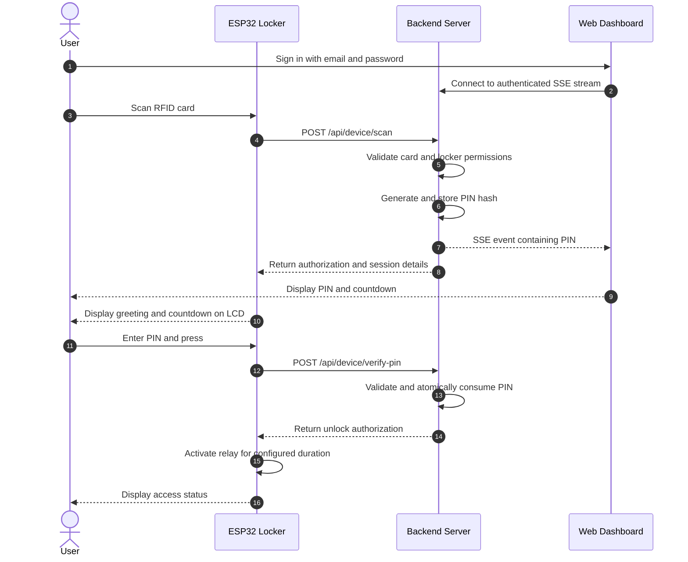
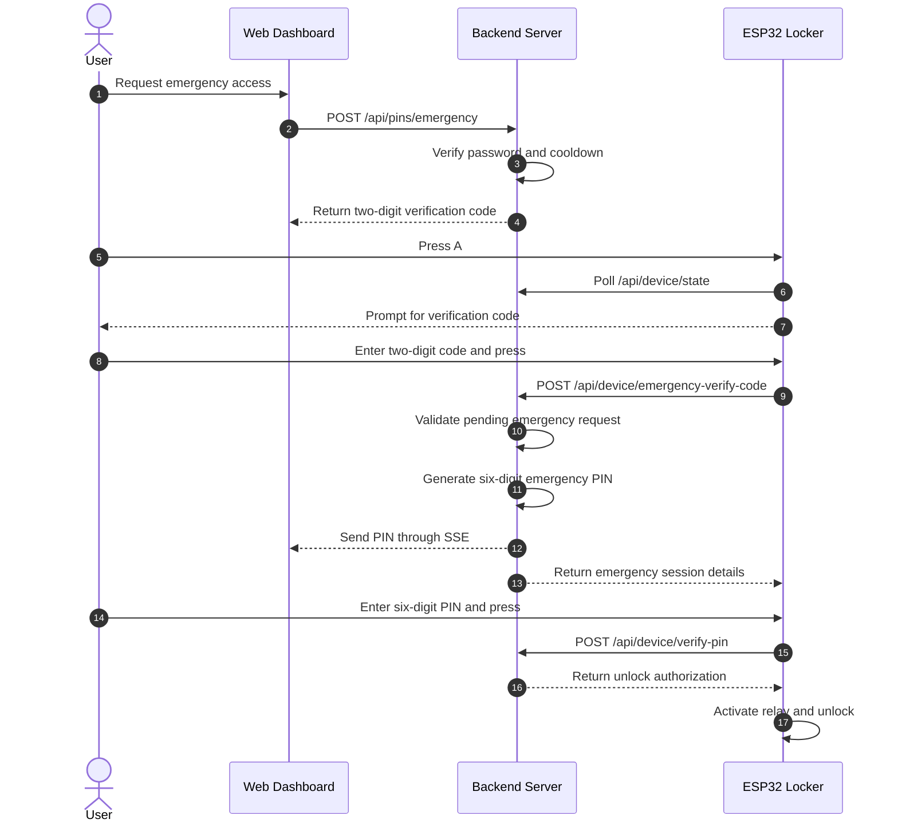

# 🔐 IoT Smart Locker System

An end-to-end IoT Smart Locker System featuring **Two-Factor Authentication (RFID + Dynamic Real-Time Web PIN)**, emergency access for lost cards, a hardware keypad and LCD interface, and a modern web management dashboard.

The system combines an **ESP32 microcontroller, RFID authentication, a Node.js backend, MongoDB, and a React dashboard** to provide controlled physical access, real-time PIN delivery, access auditing, and security lockout mechanisms.

---

## 📋 Table of Contents

1. [System Overview & Architecture](#-system-overview--architecture)
2. [Key Features](#-key-features)
3. [Repository Structure](#-repository-structure)
4. [Hardware Components & Pinout Mapping](#-hardware-components--pinout-mapping)
5. [System Workflows](#-system-workflows)
   - [Standard Two-Factor Authentication](#workflow-1-standard-two-factor-authentication)
   - [Emergency Access](#workflow-2-emergency-access)
   - [Security Lockout & Rate Limiting](#workflow-3-security-lockout--rate-limiting)
6. [API Reference](#-api-reference)
7. [Getting Started & Installation](#-getting-started--installation)
   - [Backend Setup](#1-backend-setup)
   - [Frontend Dashboard Setup](#2-frontend-dashboard-setup)
   - [ESP32 Firmware Flashing](#3-esp32-firmware-flashing)
8. [Hardware Unit Testing](#-hardware-unit-testing)
9. [Pre-Seeded Credentials & Test Accounts](#-pre-seeded-credentials--test-accounts)
10. [Troubleshooting & FAQs](#-troubleshooting--faqs)

---

## 🏗️ System Overview & Architecture

The Smart Locker System connects physical hardware to a web-based management platform to help prevent unauthorized locker access.

### Architecture Diagram

```text
+---------------------------------------------------------------+
|                       PHYSICAL LOCKER                         |
|                                                               |
|   RC522 RFID       4x4 Keypad       16x2 I2C LCD              |
|        |                |                  ^                  |
|        | SPI            | GPIO             | I2C              |
|        v                v                  |                  |
|   +-------------------------------------------------------+   |
|   |                    ESP32 Controller                   |   |
|   |                                                       |   |
|   |  Wi-Fi | Authentication | PIN Input | Relay Control   |   |
|   +-------------------------------------------------------+   |
|                              |                                |
+------------------------------|--------------------------------+
                               |
                       HTTP REST API
                               |
                               v
+---------------------------------------------------------------+
|                      BACKEND SERVER                           |
|                     Node.js + Express                         |
|                                                               |
|   REST API          MongoDB / Mongoose                        |
|   Device Auth       HMAC-SHA256 PIN Hashing                   |
|   SSE Event Hub     Rate Limiting                             |
|   Access Logs       Automatic Security Lockout                |
+------------------------------|--------------------------------+
                               |
                    HTTP REST / Server-Sent Events
                               |
                               v
+---------------------------------------------------------------+
|                     WEB DASHBOARD                             |
|                      React + Vite                              |
|                                                               |
|   Dynamic PIN Display     Emergency Access                    |
|   RFID Card Management    Live Access Logs                    |
|   Profile Management      Session Countdown                   |
+---------------------------------------------------------------+
```

### Technology Stack

| Layer | Technologies |
|---|---|
| Embedded Hardware | ESP32, RC522 RFID, 4x4 Keypad, I2C LCD |
| Actuation | 5V Relay Module, 12V DC Solenoid Lock |
| Frontend | React 18, Vite, JavaScript, CSS |
| Backend | Node.js, Express.js |
| Database | MongoDB, Mongoose |
| Authentication | JWT, HTTP Cookies, Device Credentials |
| Real-Time Communication | Server-Sent Events (SSE) |
| PIN Security | HMAC-SHA256 |
| Communication | Wi-Fi, HTTP REST API, I2C, SPI |

---

## ✨ Key Features

### 1. Dynamic Two-Factor Authentication

- **Factor 1 — Physical possession:** The user scans an authorized RFID card.
- **Factor 2 — Dynamic PIN:** A short-lived PIN is displayed on the authenticated web dashboard.
- The PIN is generated by the backend and delivered through Server-Sent Events (SSE).
- The user enters the PIN on the physical keypad to request access.
- PINs expire after two minutes and are consumed after successful verification.

### 2. Emergency Access for Lost Cards

- Users can request emergency access through the web dashboard after verifying their account password.
- The dashboard generates a unique two-digit verification code.
- The user activates emergency mode by pressing `A` on the physical keypad.
- After the verification code is accepted, the backend issues a six-digit emergency PIN.
- The emergency PIN follows the same short-lived verification process.

### 3. Secure PIN Storage

- PINs are stored as HMAC-SHA256 hashes rather than plaintext values.
- The HMAC key is maintained separately from the stored PIN hashes.
- Plaintext PINs are delivered to the authorized dashboard session through SSE.
- PIN consumption is designed to prevent reuse.

### 4. Brute-Force Protection

- Five consecutive invalid PIN attempts trigger a five-minute lockout.
- The backend rejects requests during the lockout period.
- The ESP32 displays lockout information on the LCD.
- Rate limiting and access logs support monitoring of suspicious activity.

### 5. LCD and Keypad Interface

- Displays personalized greetings and access status.
- Shows a session countdown.
- Provides masked PIN-entry feedback.
- Supports PIN submission using `#`.
- Supports input clearing and cancellation using `*`.
- Uses `A` to activate emergency access mode.

### 6. RFID Card Management

- Users can view their assigned RFID cards.
- Lost or compromised cards can be reported through the dashboard.
- Revoked cards should be rejected during subsequent authentication attempts.
- Access attempts and authorization results are recorded in audit logs.

### 7. Web Management Dashboard

- Live PIN display with a circular SVG countdown.
- Emergency access workflow.
- RFID card management.
- Access history and audit logs.
- User profile and password management.

---

## 📁 Repository Structure

```text
smart-locker/
│
├── client/                          # React + Vite frontend
│   ├── src/
│   │   ├── App.jsx                  # Main dashboard and UI workflows
│   │   ├── api.js                   # API requests and authentication
│   │   ├── main.jsx                 # React application entry point
│   │   └── styles.css               # Dashboard styling
│   ├── index.html
│   ├── package.json
│   └── vite.config.js
│
├── server/                          # Node.js backend and firmware
│   ├── src/
│   │   ├── index.js                 # Express app and DB connection
│   │   ├── middleware.js            # User and device authentication
│   │   ├── models.js                # Mongoose data models
│   │   ├── services.js              # PIN, SSE, and security services
│   │   ├── seed.js                  # Initial database seeding
│   │   └── routes/
│   │       ├── auth.js              # Authentication endpoints
│   │       ├── device.js            # ESP32 device endpoints
│   │       ├── pins.js              # PIN and emergency endpoints
│   │       └── user.js              # User, card, locker, and log APIs
│   ├── .env.example
│   ├── package.json
│   ├── test-device.sh               # Device API test script
│   └── smart_locker.ino             # Main ESP32 firmware
│
├── codes/                           # Hardware testing sketches
│   ├── keypad_testing/
│   ├── lcd_testing/
│   ├── relay_testing/
│   ├── rfid_testing/
│   ├── solenoid_relay_rfid_keypad_lcd_Testing/
│   └── smart_locker/
│
├── credentials.txt                  # Local test credentials reference
├── credentials.png                  # Credentials reference image
└── README.md
```

**Security note:** Do not commit real credentials, device secrets, JWT secrets, HMAC keys, or production passwords. Keep them in environment variables or an appropriate secrets manager. Avoid publishing credential files in a public repository.

---

## 🔌 Hardware Components & Pinout Mapping

### Required Components

1. ESP32 Development Board (ESP32-WROOM-32 / NodeMCU-32S)
2. RC522 RFID Reader and compatible RFID cards
3. 16×2 LCD with PCF8574 I2C backpack
4. 4×4 matrix membrane keypad
5. 5V active-LOW relay module
6. 12V DC solenoid lock
7. External 12V DC power supply rated for the lock's current requirements
8. 1N4007 flyback diode, where appropriate for the solenoid and switching arrangement
9. Jumper wires and a suitable prototyping board

### ESP32 Pin Assignment

#### RC522 RFID Reader

| RC522 Pin | ESP32 Pin | Description |
|---|---|---|
| 3.3V | 3V3 | Power supply |
| GND | GND | Ground |
| RST | GPIO 15 | Reset |
| MISO | GPIO 19 | SPI data to ESP32 |
| MOSI | GPIO 23 | SPI data from ESP32 |
| SCK | GPIO 18 | SPI clock |
| SDA / SS | GPIO 5 | SPI chip select |

**Important:** Power the RC522 from 3.3V, not 5V.

#### 16×2 I2C LCD

| LCD Pin | ESP32 Pin | Description |
|---|---|---|
| VCC | VIN / 5V | Power, if supported by the module |
| GND | GND | Ground |
| SDA | GPIO 21 | I2C data |
| SCL | GPIO 22 | I2C clock |

The commonly used I2C addresses are `0x27` and `0x3F`. Confirm the actual address using an I2C scanner.

**Electrical compatibility:** Some LCD backpacks pull SDA and SCL up to 5V when powered from 5V. ESP32 GPIOs are not 5V tolerant. Verify the backpack's I2C voltage levels and use a suitable bidirectional level shifter if required.

#### 4×4 Matrix Keypad

| Keypad Pin | ESP32 GPIO |
|---|---|
| Row 1 (R1) | GPIO 13 |
| Row 2 (R2) | GPIO 12 |
| Row 3 (R3) | GPIO 14 |
| Row 4 (R4) | GPIO 27 |
| Column 1 (C1) | GPIO 26 |
| Column 2 (C2) | GPIO 25 |
| Column 3 (C3) | GPIO 33 |
| Column 4 (C4) | GPIO 32 |

#### Relay Module

| Relay Pin | ESP32 / Power Connection |
|---|---|
| VCC | 5V / VIN, if supported |
| GND | Common ground as required by the module |
| IN | GPIO 4 |

The firmware uses the following control logic:

- `LOW` → Relay ON → Unlock request.
- `HIGH` → Relay OFF → Lock request.

Confirm the relay module's trigger logic before connecting the solenoid.

#### Solenoid Lock and Power Supply

The solenoid must be powered by a suitable external supply. Never power it directly from an ESP32 GPIO pin.

For a typical normally-open relay switching a positive supply:

- Connect external 12V positive to relay `COM`.
- Connect relay `NO` to the solenoid positive terminal.
- Connect the solenoid negative terminal to external 12V negative.
- Wire the relay control and grounds according to the relay module's requirements.

Use a properly rated flyback suppression component across the solenoid, observing its polarity and the switching topology. A diode is commonly installed with its cathode toward positive supply and anode toward the switched negative side for a DC solenoid switched on the low side. Confirm the appropriate arrangement for your circuit before applying power.

### Keypad Layout

```text
        C1   C2   C3   C4

R1      1    2    3    A
R2      4    5    6    B
R3      7    8    9    C
R4      *    0    #    D
```

| Key | Function |
|---|---|
| `0–9` | Enter PIN or verification code |
| `A` | Activate emergency access |
| `*` | Clear input or exit the current mode |
| `#` | Submit entered code |

---

## 🔄 System Workflows

### Workflow 1: Standard Two-Factor Authentication



**Step-by-step process**

1. The user signs in to the dashboard.
2. The user scans an RFID card on the RC522 reader.
3. The ESP32 submits the card UID to `/api/device/scan`.
4. The backend verifies the card status, ownership, and locker permissions.
5. The backend generates a four-digit PIN with a two-minute validity period.
6. The PIN hash is stored, while the plaintext PIN is sent to the authorized dashboard session through SSE.
7. The user enters the displayed PIN on the physical keypad and presses `#`.
8. The backend verifies the PIN and consumes it to prevent reuse.
9. The ESP32 activates the relay for the configured unlock duration.
10. The locker returns to its locked state.

### Workflow 2: Emergency Access



**Emergency access controls**

- A password-protected request initiates the process.
- A two-minute cooldown applies between eligible requests, according to the backend's configured policy.
- The two-digit verification code expires after five minutes.
- The resulting six-digit emergency PIN expires after two minutes.
- The physical keypad is required to complete verification.

Emergency access should be treated as a separate authentication workflow and audited independently from normal RFID access.

### Workflow 3: Security Lockout & Rate Limiting

The system is designed to reject repeated incorrect PIN attempts.

1. Five consecutive invalid PIN attempts trigger a five-minute lockout.
2. The backend rejects further protected requests during the lockout.
3. The ESP32 displays a lockout message on the LCD.
4. Invalid requests should receive an appropriate HTTP error response, such as `429 Too Many Requests`.
5. The device returns to normal operation when the lockout expires.

The backend should remain authoritative for lockout enforcement. A device-side timer or UI message alone is not a sufficient security control.

---

## 📡 API Reference

### Device Endpoints

These endpoints are consumed by the ESP32 firmware.

**Required device authentication headers:**

```http
x-device-id: LOCKER-01
x-device-key: <DEVICE_KEY>
Content-Type: application/json
```

| Method | Endpoint | Purpose |
|---|---|---|
| `POST` | `/api/device/scan` | Submit an RFID UID |
| `GET` | `/api/device/state` | Poll current locker and session state |
| `POST` | `/api/device/emergency-verify-code` | Verify the two-digit emergency code |
| `POST` | `/api/device/verify-pin` | Verify the entered PIN |

#### 1. Scan RFID Card

`POST /api/device/scan`

Request:

```json
{
  "uid": "53373FFA"
}
```

Example response:

```json
{
  "ok": true,
  "name": "Alice",
  "ttlMs": 120000,
  "watching": true
}
```

#### 2. Poll Locker State

`GET /api/device/state`

Example response:

```json
{
  "active": true,
  "type": "standard",
  "remainingMs": 114000
}
```

#### 3. Verify Emergency Code

`POST /api/device/emergency-verify-code`

Request:

```json
{
  "code": "47"
}
```

The backend validates the pending request and returns the emergency session details if verification succeeds.

#### 4. Verify PIN

`POST /api/device/verify-pin`

Request:

```json
{
  "pin": "4821"
}
```

Example success response:

```json
{
  "unlock": true,
  "holdMs": 4000
}
```

### Web Dashboard Endpoints

| Method | Endpoint | Purpose |
|---|---|---|
| `POST` | `/api/auth/login` | Authenticate a user |
| `POST` | `/api/auth/logout` | End the user session |
| `GET` | `/api/auth/me` | Retrieve the current user profile |
| `GET` | `/api/pins/stream` | Receive real-time PIN events through SSE |
| `POST` | `/api/pins/emergency` | Request emergency access |
| `GET` | `/api/lockers` | List accessible lockers |
| `GET` | `/api/cards` | List assigned RFID cards |
| `POST` | `/api/cards/:id/report-lost` | Report and revoke a lost card |
| `GET` | `/api/logs` | Retrieve access logs |
| `PUT` | `/api/user/profile` | Update profile or password |

**Authentication:** User endpoints require the configured user authentication mechanism. The SSE endpoint uses the supported authenticated session or token mechanism. Device endpoints use device-specific credentials.

---

## 🚀 Getting Started & Installation

### Prerequisites

Install the following software before starting:

- **Node.js:** Version 18 or later, subject to the project's dependency requirements.
- **npm:** Included with Node.js.
- **MongoDB:** Local Community Server or MongoDB Atlas.
- **Arduino IDE:** Version 2.x.
- **ESP32 board support:** ESP32 by Espressif Systems.
- **Hardware libraries:** MFRC522, LiquidCrystal_I2C, Keypad, and ArduinoJson.
- **Hardware:** ESP32, RFID reader, keypad, LCD, relay, and solenoid lock.

### 1. Backend Setup

Navigate to the backend directory:

```bash
cd server
npm install
```

Create a `.env` file using `.env.example` as a template.

Example development configuration:

```ini
PORT=5000
MONGO_URI=mongodb://127.0.0.1:27017/smart_locker
JWT_SECRET=replace-with-a-long-random-secret
PIN_SECRET=replace-with-a-separate-random-secret
PIN_LENGTH=4
DEVICE_KEY=replace-with-a-random-device-key
```

Use separate, randomly generated secrets for `JWT_SECRET`, `PIN_SECRET`, and `DEVICE_KEY`. Never reuse the example values in a real deployment.

Seed the development database:

```bash
npm run seed
```

Start the backend:

```bash
npm run dev
```

The backend should be available at:

```text
http://localhost:5000
```

**Note:** The exact available npm scripts depend on `server/package.json`. Use the scripts defined in your repository if they differ from these examples.

### 2. Frontend Dashboard Setup

Open a second terminal:

```bash
cd client
npm install
npm run dev
```

Vite typically serves the dashboard at:

```text
http://localhost:5173
```

Open the URL in your browser and sign in with a seeded development account.

### 3. ESP32 Firmware Flashing

Open Arduino IDE and install the required libraries through **Sketch → Include Library → Manage Libraries**.

Required libraries:

- `MFRC522`
- `LiquidCrystal_I2C`
- `Keypad`
- `ArduinoJson`

Open the firmware:

```text
server/smart_locker.ino
```

Update the firmware configuration with your Wi-Fi credentials and the computer's local network address:

```cpp
const char* WIFI_SSID = "YOUR_WIFI_SSID";
const char* WIFI_PASS = "YOUR_WIFI_PASSWORD";
const char* SERVER_URL = "http://192.168.0.XXX:5000";
```

Replace the example IP address with the current IPv4 address of the computer running the backend.

On Windows, run:

```powershell
ipconfig
```

Find the IPv4 address of the active Wi-Fi adapter.

Before uploading:

1. Ensure the computer and ESP32 are connected to the same reachable network.
2. Ensure the backend is running.
3. Configure Windows Firewall to permit the required local connection.
4. Select **ESP32 Dev Module** or the correct board variant.
5. Select the ESP32's COM port.
6. Upload the sketch.
7. Open Serial Monitor at `115200` baud.
8. Check the serial output for Wi-Fi and backend connection status.

**Important:** `localhost` and `127.0.0.1` refer to the device running the code. The ESP32 must use the computer's reachable LAN address, not `localhost`.

---

## 🧪 Hardware Unit Testing

Test each hardware component independently before running the full connected system.

| Sketch Directory | Component | Purpose |
|---|---|---|
| `codes/keypad_testing/` | 4×4 Keypad | Verify key detection |
| `codes/lcd_testing/` | I2C LCD | Test display output and I2C communication |
| `codes/relay_testing/` | Relay and Solenoid | Test relay switching and lock actuation |
| `codes/rfid_testing/` | RC522 RFID | Read card UIDs |
| `codes/solenoid_relay_rfid_keypad_lcd_Testing/` | Integrated Hardware | Test offline RFID, keypad, LCD, and relay operation |
| `codes/smart_locker/` | ESP32 Firmware | Standalone firmware backup |

### Recommended Testing Sequence

1. Verify the ESP32 board and serial communication.
2. Run the RFID reader test and confirm that card UIDs are detected.
3. Run the LCD test and verify text output.
4. Run the keypad test and verify every key.
5. Test relay switching without connecting the solenoid.
6. Verify the external power supply and solenoid wiring.
7. Run the integrated offline hardware test.
8. Start MongoDB and the backend.
9. Test RFID authentication and dynamic PIN delivery.
10. Test emergency access, card revocation, PIN expiry, and lockout.

This sequence isolates wiring and component problems before introducing networking and backend dependencies.

---

## 👥 Pre-Seeded Credentials & Test Accounts

Running `npm run seed` creates the development accounts listed below, according to the supplied seed configuration.

All accounts use the example development password `password123`.

| User | Role | Login Email | Sample Card UID |
|---|---|---|---|
| Alice Johnson | User | `alice@locker.dev` | `53373FFA` |
| Bob Smith | User | `bob@locker.dev` | `13C075F7` |
| Charlie Davis | User | `charlie@locker.dev` | `C3746935` |
| Diana Prince | User | `diana@locker.dev` | `73D11330` |
| Evan Wright | User | `evan@locker.dev` | `39624407` |
| Demo Admin | Admin | `demo@locker.dev` | `AB12CD34` |

### Development Device Configuration

| Setting | Example Value |
|---|---|
| Device ID | `LOCKER-01` |
| Device key | Configure through `.env` |

These accounts and card UIDs are intended for development and demonstration only.

**Before publishing:** Remove publicly accessible passwords, device keys, production credentials, and any other secrets from tracked files. Rotate any real credentials that have already been exposed.

---

## ❓ Troubleshooting & FAQs

### 1. LCD Shows Black Boxes or No Text

- Check the LCD power and common ground.
- Verify SDA is connected to GPIO 21 and SCL to GPIO 22.
- Adjust the contrast potentiometer on the I2C backpack.
- Run an I2C scanner to find the actual address, commonly `0x27` or `0x3F`.
- Verify that the library constructor uses the correct address and display dimensions.

### 2. RFID Reader Does Not Detect Cards

- Confirm that the RC522 is powered from 3.3V.
- Check the SPI connections:

```text
SDA / SS -> GPIO 5
RST      -> GPIO 15
MOSI     -> GPIO 23
MISO     -> GPIO 19
SCK      -> GPIO 18
```

- Verify the ground connection.
- Run the standalone RFID testing sketch.
- Confirm that the detected card UID matches the UID stored in the database.

### 3. ESP32 Cannot Connect to the Backend

- Ensure the ESP32 and backend computer can communicate over the same reachable network.
- Verify the computer's current LAN IPv4 address.
- Confirm the backend is listening on port `5000`.
- Check Windows Firewall rules.
- Verify the configured `SERVER_URL`.
- Check the device ID and device key.
- Inspect the backend terminal and ESP32 Serial Monitor for errors.

### 4. Dashboard Does Not Receive the Dynamic PIN

- Sign in with the account associated with the scanned RFID card.
- Confirm the browser has an active SSE connection.
- Check that `/api/pins/stream` is reachable and properly authenticated.
- Inspect browser developer tools for connection or authorization errors.
- Check backend logs for PIN issuance and SSE delivery events.

### 5. Relay Clicks but the Solenoid Does Not Retract

- Confirm the solenoid's rated voltage and current.
- Verify that the external power supply can provide the required current.
- Check the relay's `COM` and `NO` terminals.
- Confirm that the relay's trigger polarity matches the firmware.
- Check the wiring and suppression component.
- Never connect the solenoid directly to an ESP32 GPIO pin.

### 6. ESP32 Fails to Upload Firmware

- Confirm that the correct COM port is selected.
- Install the appropriate USB-to-UART driver if needed.
- Select the correct ESP32 board variant.
- Use a USB data cable rather than a charge-only cable.
- Try entering bootloader mode using the board's `BOOT` button if the upload fails to connect.
- Disconnect peripherals that may interfere with bootstrapping pins during upload.

### 7. PIN Verification Fails

- Confirm the PIN belongs to the current locker session.
- Check whether the PIN has expired.
- Verify the configured PIN length.
- Confirm that the backend and ESP32 are communicating with the correct server.
- Check whether the PIN was already consumed or the user is locked out.

---

## 🔒 Security Considerations

This project is intended for educational use and controlled prototyping. The security mechanisms described above should be independently tested before any real-world deployment.

For stronger security:

- Use HTTPS and authenticated device communication outside an isolated development network.
- Store secrets outside source control and rotate them when exposed.
- Enforce authorization and rate limits on the backend, not only on the ESP32.
- Make PIN verification and consumption atomic to prevent replay and race conditions.
- Use cryptographically secure random generation for PINs and emergency codes.
- Protect session cookies using appropriate `HttpOnly`, `Secure`, and `SameSite` attributes.
- Avoid exposing long-lived authentication tokens in URLs, including SSE query parameters, because URLs may be logged.
- Record access attempts, lockouts, card revocations, and emergency access events.
- Review relay fail-safe behavior and provide a safe mechanical override for emergencies.
- Test power-loss recovery, network outages, expired sessions, and unauthorized device requests.

**Security clarification:** Hashing short PINs does not by itself make them resistant to brute-force attacks. HMAC verification must be combined with server-side attempt limits, expiry, single-use enforcement, and appropriate secret management.

---
